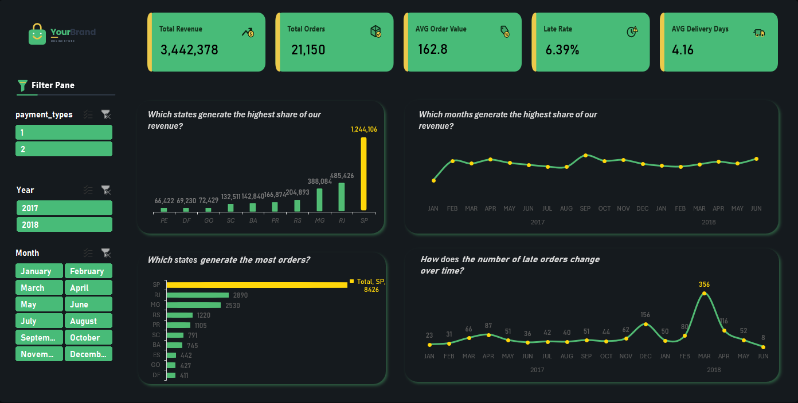

# E-Commerce Sales & Delivery Performance Dashboard (Excel)

<div align="center">


### An Interactive Excel Dashboard Built on a Power Pivot Data Model, Tracking Revenue, Order Volume, Regional Demand and Delivery Reliability for an Online Marketplace

[📊 Live Portfolio Overview](https://nady-07.github.io/portfolio/#projects) · [📥 Download .XLSX File](./Ecommerce_Project.xlsx) · [💼 Connect on LinkedIn](https://www.linkedin.com/in/mohamed-alnady-52b87123b)

</div>

---

## 📌 Executive Summary

Online marketplaces can grow revenue while quietly losing customers to slow or failed deliveries. Sales figures alone hide that risk, so revenue and fulfilment need to be read side by side.

This project is a fully interactive **Excel dashboard** that does exactly that for **21,150 orders** placed across Brazilian states between **January 2017 and June 2018**. It is powered by a **Power Pivot data model** (3 fact tables, 5 dimension tables including a calendar, and a metric-definitions reference table) loaded with **Power Query**, with the business logic written as **9 DAX measures**. The dashboard reports **3.44M in net revenue**, an average order value of **162.8** and a **6.39% late-delivery rate (1,351 late orders)**, and shows that **São Paulo (SP) alone drives 36% of revenue and 40% of orders**.

Everything is built natively in Excel: PivotTables, PivotCharts, slicers and linked KPI cards, with no add-ins or external BI tool.

> **Note:** This is a portfolio project. The "YourBrand" logo is a placeholder, not a real company.

---

## 🚀 Key Business Metrics & Findings

| Metric Domain | KPI | Value | Business Context & Insight |
| :--- | :--- | :--- | :--- |
| **Commercial Top-Line** | Net Revenue | **3,442,378** | Revenue is stable at roughly 180K–210K a month through 2017–2018, with a September 2017 peak of **223.6K**. |
| **Order Volume** | Total Orders | **21,150** | Across Brazilian customer states over 18 months. |
| **Basket Value** | Average Order Value | **162.8** | Bahia (BA) has the highest value per order among the top states (**191.7**), while São Paulo has the lowest (**147.7**). |
| **Delivery Reliability** | Late Rate | **6.39%** | **1,351** late orders, so about 93.6% of orders arrive on time. |
| **Delivery Speed** | Average Delivery Time | **13.05 days** | Actual days from order to delivery, averaged across all orders. |
| **Customer Satisfaction** | Average Review Score | **4.16** | Average of customer review scores across all orders. |
| **Geographic Concentration** | São Paulo Share | **36.1% of revenue** | **1,244,106** in revenue and **8,426** orders (39.8% of the total). The top 3 states (SP, RJ, MG) account for **61.5%** of revenue. |
| **Fulfilment Risk** | March 2018 Late Orders | **356** | One month holds **26%** of all late orders. December 2017 adds another 156, and the two months together hold 38%. |

---

## 📸 Dashboard Walkthrough & Architecture

### Dashboard: Sales & Delivery Overview
A single-page executive dashboard with a KPI strip, four question-driven charts and a slicer-based filter pane. Every chart and card responds to the slicers.



* **KPI Strip:** Total Revenue (3,442,378) · Total Orders (21,150) · Average Order Value (162.8) · Late Rate (6.39%). The cards are text boxes linked directly to PivotTable cells, so they update with every filter.
* **Filter Pane:** Slicers for **payment types**, **year** (2017, 2018) and **month** let a user cut the whole dashboard in one click.
* **Which states generate the highest share of revenue?** São Paulo leads with **1,244,106**, followed by Rio de Janeiro (**485,426**) and Minas Gerais (**388,084**). Rio Grande do Sul (204,893), Paraná (166,874), Bahia (142,840) and Santa Catarina (132,511) follow, and the top 10 states cover 86% of revenue.
* **Which states generate the most orders?** SP (**8,426**) is nearly three times RJ (2,890), with MG (2,530), RS (1,220) and PR (1,105) next. Espírito Santo (442) makes the top 10 by orders but not by revenue.
* **Which months generate the highest share of revenue?** After a ramp-up from **127K in January 2017**, monthly revenue holds in a narrow band of about 180K–225K, with a peak in **September 2017 (223.6K)** and a strong close in June 2018 (**210K**).
* **How does the number of late orders change over time?** Late orders mostly run between 23 and 87 a month, then spike to **156 in December 2017** and **356 in March 2018** (116 in April), before falling to 8 in June 2018. Revenue in March 2018 (188.8K) was in line with neighboring months, which suggests a fulfilment problem rather than a demand surge.

---

### Workbook Structure
The workbook has two sheets, kept deliberately separate so the dashboard stays clean.

* **`PT_DB1`** — The calculation sheet. It holds the five PivotTables that feed the dashboard: the KPI block, revenue by month, late orders by month, revenue by state and orders by state.
* **`Dashboard1`** — The presentation sheet. It holds the KPI cards, four PivotCharts, the slicers and the layout.

---

### Data Model: Power Pivot
Data is loaded with **Power Query** into the Excel Data Model, which contains the following tables:

* **Fact Tables:**
  * `fact_orders` — Order-level transactions, including net revenue, gross merchandise value, review score, delivery days and a late-delivery flag.
  * `fact_category_performance` — Pre-aggregated performance by product category, including late rate and average delivery days.
  * `fact_seller_performance` — Pre-aggregated performance by seller.
* **Dimension Tables:**
  * `dim_customers` — Customer city and state.
  * `dim_seller` — Seller attributes.
  * `dim_category` — Product category attributes.
  * `dim_state_targets` — State-level targets, loaded into the model and not yet used by the current dashboard visuals.
  * `dim_calendar` — Date table with year, month and a date hierarchy for time analysis.
* **Reference Table:**
  * `ref_metric_definitions` — A reference table holding the metric definitions used in the report.

---

## 🧮 Selected DAX Measures Catalog

All business metrics are defined once in the data model and reused by every PivotTable, which keeps the dashboard consistent. `DIVIDE` is used for safe division.

### 1. Sales Performance
```dax
// Number of orders in the current filter context
[total_order] =
COUNTROWS(fact_orders)

// Net revenue (sum of the net_revenue column)
[revenue] =
SUM(fact_orders[net_revenue])

// Revenue per order
[avg_order_value] =
DIVIDE([revenue], [total_order], 0)

// Gross merchandise value (sum of the gross_merchandise_value column)
[total_gmv] =
SUM(fact_orders[gross_merchandise_value])
```

### 2. Delivery Reliability
```dax
// Orders delivered late
[total_late_orders] =
CALCULATE(
    COUNTROWS(fact_orders),
    fact_orders[is_late] = 1
)

// Share of orders delivered late
[late_rate%] =
DIVIDE([total_late_orders], [total_order])

// Share of orders delivered on time
[on_time_rate_%] =
1 - [late_rate%]

// Average actual delivery time in days
[avg_delivery_day] =
AVERAGE(fact_orders[actual_delivery_days])
```

### 3. Customer Experience
```dax
// Average customer review score
[avg_reviews] =
AVERAGE(fact_orders[review_score])
```

---

## 💡 Strategic Recommendations & Action Playbook

Based on the quantitative findings surfaced by this dashboard, the proposed action plan is ordered by urgency:

1. **Root-Cause the Late-Delivery Spikes (Immediate):**
   * March 2018 (**356 late orders**) and December 2017 (**156**) account for 38% of all late orders, so review carrier, seller and regional performance for those months first.
   * The model already includes `fact_seller_performance` and `fact_category_performance` to support this drill-down.
2. **Protect the São Paulo Engine (Short term):**
   * SP delivers **36% of revenue and 40% of orders**, so any fulfilment disruption there hits the whole business. Review warehouse capacity, carrier SLAs and peak-season buffers for the state.
3. **Build Depth Outside the Top 3 States (Ongoing):**
   * SP, RJ and MG make up **61.5%** of revenue. Bahia combines a low order count (745) with the highest order value (**191.7**), which makes it a candidate for targeted growth campaigns.
4. **Monitor Delivery Health Monthly (Ongoing):**
   * Keep `late_rate%` and `avg_delivery_day` on the monthly review next to revenue, and set an alert threshold above the current 6.39% baseline.
5. **Put the State Targets to Work (Ongoing):**
   * `dim_state_targets` is already loaded in the model, so a revenue-versus-target view by state would be a natural next iteration.

---

## 🛠️ How to Open & Inspect the Project

1. **Prerequisites:** Install desktop **Microsoft Excel** (2016 or later, or Microsoft 365). The Data Model, PivotCharts and slicers are not fully supported in Excel for the web.
2. **Clone this repository:**
   ```bash
   git clone https://github.com/Nady-07/Ecommerce-Sales-Delivery-Dashboard.git
   ```
3. **Open the workbook:** Double-click [`Ecommerce_Project.xlsx`](./Ecommerce_Project.xlsx) and enable editing if prompted.
4. **Explore the project:** Use the slicers on `Dashboard1`, check the PivotTables on `PT_DB1`, and open **Data → Manage Data Model** to inspect the tables and DAX measures.

---

## 👨‍💻 Author & Contact

**Mohamed Al Nady** — *Data Analyst specializing in SQL, Power BI, DAX, and Data Warehousing*
* 🌐 **Portfolio:** [nady-07.github.io/portfolio](https://nady-07.github.io/portfolio/)
* 💼 **LinkedIn:** [linkedin.com/in/mohamed-alnady-52b87123b](https://www.linkedin.com/in/mohamed-alnady-52b87123b)
* 📧 **Email:** [mohamednady0@outlook.com](mailto:mohamednady0@outlook.com)
* 🐙 **GitHub:** [@Nady-07](https://github.com/Nady-07)
